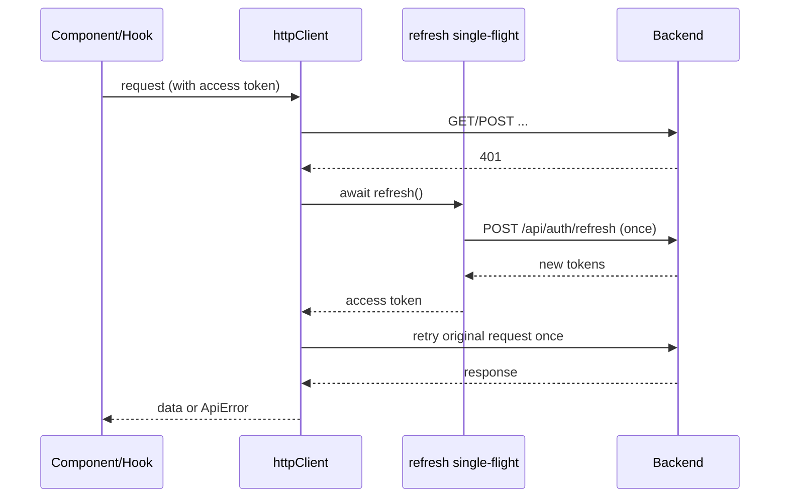

# Frontend API Integration — RAG Assistant

> **Status:** Contract reference for the React application. The foundation exists, but it has **no HTTP client or API layer** and makes no requests yet.
> **Rule:** Only contracts verified in backend source may be documented as endpoints. Nothing here may be invented.
> **Backend baseline:** `RagAssistantApi` at commit `afd92ec`, source-inspected 2026-11-15. **The backend does not compile at this commit** (`RagAssistant.Api/Controllers/ChatController.cs:31`), so every contract below is **source-verified, not runtime-verified**.
> **Last updated:** 2026-11-15
>
> Related: [Architecture](./frontend-architecture.md) · [Security](./frontend-security-standards.md) · [Testing](./frontend-testing-standards.md) · [Project context](../../PROJECT_CONTEXT.md)

---

## 1. Evidence and Confidence Levels

Each API item is labeled:

| Level | Meaning |
|---|---|
| **Verified (source)** | Route, DTO, and behavior read directly from backend code at the stated commit |
| **Unverified (runtime)** | Not executed; no database, Qdrant, Ollama, or running API was available |
| **Not implemented** | No route exists; do not call it |
| **Proposed** | A suggested contract that requires backend approval; **not** callable |

No endpoint may move from "Not implemented" to "Verified" without a backend change and a re-inspection of the source.

---

## 2. Base Configuration

| Item | Value | Evidence |
|---|---|---|
| Base path | `/api` (routes are declared without a global prefix; each controller declares `api/...`) | `AuthController`, `ChatController` |
| API versioning | None | `Program.cs` |
| Default JSON casing | camelCase (ASP.NET Core MVC web defaults; no custom `JsonOptions` in `Program.cs`) | `Program.cs` |
| Auth scheme | `Authorization: Bearer <accessToken>` | `JwtBearerDefaults.AuthenticationScheme` |
| Dev HTTP origin | `http://localhost:5000` | `launchSettings.json` (`http` profile) |
| Dev HTTPS origin | `https://localhost:7189` | `launchSettings.json` (`https` profile) |
| Swagger UI | `/swagger` — **Development only** | `Program.cs` |
| OpenAPI document | `/swagger/v1/swagger.json` — Development only, requires a successful build | `Program.cs` |
| CORS | **None configured** | no `AddCors`/`UseCors` |
| Rate limiting | **None** | `Program.cs` |

### 2.1 Development proxy

Because CORS is not configured, development must proxy `/api` through Vite:

```ts
// vite.config.ts (proposed)
server: {
  port: 5173,
  proxy: {
    '/api': {
      target: 'http://localhost:5000',
      changeOrigin: true,
    },
  },
}
```

The frontend then uses relative paths (`/api/auth/login`) with `VITE_API_BASE_URL` empty. Production uses the same relative paths behind a same-origin reverse proxy. Do not add CORS workarounds in the client.

> Verify the effective backend origin at integration time. `UseHttpsRedirection` behaves differently depending on the launch profile and whether an HTTPS port is configured.

---

## 3. Response Envelope

All controller actions return `RagAssistant.Domain.Results.ApiResponse<T>`.

```ts
export interface ApiResponse<T> {
  isSuccess: boolean;
  value: T | null;
  message: string;
  errors: string[];
  statusCode: number;
}
```

Verified behavior:

- `isSuccess` has only a getter but is serialized by `System.Text.Json`.
- `message` defaults to the Persian string «عملیات با موفقیت انجام شد» on some success paths.
- `value` is `null` for message-only successes (for example, change password).
- **Controllers return the object, not an `ActionResult`, so most failures still arrive with HTTP 200.**
- `ApiResponse<T>.Failure(message, errors, statusCode)` **ignores** its `statusCode` argument and always sets `statusCode: 400` in the body (`Result.cs`). Never trust the body's `statusCode`; use the HTTP status plus `isSuccess`.
- There is no `[ProducesResponseType]` metadata, so Swagger status codes may be incomplete.
- There is no request correlation ID.

### 3.1 Success decision (mandatory)

```ts
const isSuccess = response.ok && body?.isSuccess === true;
```

Do not treat HTTP 200 alone as success. Do not treat `body.statusCode === 200` as proof of success.

---

## 4. Verified Authentication Endpoints

Controller: `AuthController`, route prefix `api/auth`.

### 4.1 POST `/api/auth/login`

| Property | Value |
|---|---|
| Auth | Anonymous |
| Request body | `{ "username": string, "password": string }` |
| Success | HTTP 200, `ApiResponse<JwtTokenResult>`, `isSuccess: true` |
| Invalid credentials | **HTTP 204 with no body** (`return null` from the action) |
| Inactive user | Same as invalid credentials (provider returns `null`) |
| Rate limiting | None |

The frontend must treat 204 as "invalid credentials" and show a generic message. It must not distinguish unknown user from wrong password.

```ts
export interface LoginRequest {
  username: string;
  password: string;
}

export interface JwtTokenResult {
  accessToken: string;
  refreshToken: string;
  accessTokenExpiresAtUtc: string;   // ISO 8601, UTC
  refreshTokenExpiresAtUtc: string;  // ISO 8601, UTC
  expiresInSeconds: number;
  tokenType: string;                 // "Bearer"
  refreshTokenFamilyId: string;
}
```

### 4.2 POST `/api/auth/refresh`

| Property | Value |
|---|---|
| Auth | Anonymous |
| Request body | `{ "refreshToken": string }` |
| Success | HTTP 200, `ApiResponse<JwtTokenResult>`, `isSuccess: true`; both tokens are replaced |
| Failure | HTTP 200, `ApiResponse` with `isSuccess: false`, `statusCode: 400` (despite a requested 401) |
| Rotation | Family-based; a reused/revoked token revokes the **entire family** |

**Frontend rule:** exactly one refresh in flight per tab; never retry an ambiguous refresh. See [security standards §5](./frontend-security-standards.md#5-refresh-concurrency--critical-backend-constraint).

```ts
export interface RefreshTokenRequest {
  refreshToken: string;
}
```

### 4.3 POST `/api/auth/logout`

| Property | Value |
|---|---|
| Auth | Anonymous (the refresh token in the body identifies the session) |
| Request body | `{ "refreshToken": string }` |
| Success | HTTP 200, `ApiResponse` with `isSuccess: true`, no value |
| Failure | HTTP 200, `ApiResponse` with `isSuccess: false` |
| Note | The current access token remains valid until it expires |

### 4.4 POST `/api/auth/logout-all`

| Property | Value |
|---|---|
| Auth | `[Authorize]` |
| Request body | none |
| Success | HTTP 200, `ApiResponse` with `isSuccess: true` |
| Behavior | Revokes all refresh tokens and rotates the security stamp; existing access tokens fail validation on their next request |
| Unauthenticated | Framework `401` with an empty body |

### 4.5 POST `/api/auth/change-password`

| Property | Value |
|---|---|
| Auth | `[Authorize]` |
| Request body | `{ "currentPassword": string, "newPassword": string }` |
| Success | HTTP 200, `ApiResponse` with `isSuccess: true` and `message: "Password changed successfully."` |
| Wrong current password | HTTP 200, `isSuccess: false`, message `" Current password is incorrect."` (leading space in source) |
| Behavior | Rotates password hash, rotates the security stamp, revokes all refresh tokens |

**Frontend rule:** clear the session and redirect to login on success. The current access token is now invalid.

```ts
export interface ChangePasswordRequest {
  currentPassword: string;
  newPassword: string;
}
```

### 4.6 Authentication notes

- Access token lifetime is 15 minutes; refresh token lifetime is 7 days (configuration values; runtime unverified).
- `JwtTokenResult.refreshTokenFamilyId` is informational; the client does not need it.
- Do not decode the token to decide authorization. Display use only (see security doc).
- No `/api/auth/me`, `/api/auth/register`, password reset, or MFA endpoints exist.

---

## 5. HTTP Client Architecture

```text
Feature API module
  → httpClient.request<T>(path, { method, body, signal, ... })
      → build URL (VITE_API_BASE_URL + path)
      → attach Authorization if an access token exists
      → fetch with signal
      → classify response (204 / JSON / HTML / empty / network error)
      → parse envelope
      → on 401 for a protected request: single-flight refresh, retry once
      → return T or throw ApiError
```

### 5.1 Responsibilities

| Layer | Owns |
|---|---|
| `src/api/http-client.ts` | base URL, headers, timeout, abort composition, 401 refresh orchestration, envelope parsing, error normalization |
| `src/api/api-error.ts` | error type and classification |
| `src/api/types/*` | wire DTOs |
| `src/features/*/api/*` | endpoint paths, request mapping, query/mutation hooks |

The HTTP client must not know feature names or UI copy. It returns typed data or throws a typed `ApiError`; components map errors to Persian messages.

### 5.2 Request conventions

- `Accept: application/json`.
- `Content-Type: application/json` only when sending a JSON body.
- `Authorization: Bearer <token>` only when a token exists and the request is not login/refresh.
- No custom headers without a documented reason.
- No credentials mode changes (`credentials: 'same-origin'` default).
- Use exact declared paths. Do not add trailing slashes or `/v1`.
- Method semantics follow the backend: currently only `GET`, `POST`, `DELETE` appear; no `PATCH`/`PUT` exists.

### 5.3 Timeouts

| Request class | Timeout | Rationale |
|---|---|---|
| Standard API calls | 15 s | Fail fast on a stalled network |
| Refresh | 15 s | Must not hang session restore |
| Chat completion | up to 10 min | Backend Ollama timeout is 10 minutes; the UI must offer cancel |
| Uploads | no fixed timeout | Use progress and explicit cancel |

Compose the caller signal and the timeout with `AbortSignal.any([signal, AbortSignal.timeout(ms)])`. Distinguish an intentional abort from a timeout using `signal.reason`.

### 5.4 401 and refresh flow



Rules:

- The retry carries an internal "already retried" marker; a second 401 becomes a session-expired error.
- Never refresh for `/api/auth/login`, `/api/auth/refresh`, or `/api/auth/logout`.
- Never start more than one refresh. All callers await the same promise.
- If refresh fails for any reason, clear the session and emit a single `session-expired` event; do not show one toast per failed request.
- Do not refresh on `403`; that is an authorization decision.

### 5.5 Response classification

| Response | Classification | UI behavior |
|---|---|---|
| 2xx JSON envelope, `isSuccess: true` | Success | Return `value` |
| 2xx JSON envelope, `isSuccess: false` | API failure | Show `message` (safe text); map by HTTP status |
| 204, no body | Empty (login failure) | Generic invalid-credentials message for login; otherwise "no content" success |
| 401, empty body | Unauthorized | Refresh → retry once → login |
| 403, empty body | Forbidden | Permission state; no retry |
| 404 | Not found | Not-found state |
| 400/422 JSON envelope | Validation | Field/form errors when `errors` is present |
| 5xx HTML or empty | Server error | Generic server error; never render the body |
| 2xx non-JSON | Contract error | Developer-visible error; safe user message |
| `fetch` rejection (network) | Network error | Offline/connection message |
| Abort (intentional) | Aborted | No error toast |

### 5.6 Error model

```ts
export type ApiErrorKind =
  | 'network'
  | 'timeout'
  | 'aborted'
  | 'unauthorized'
  | 'forbidden'
  | 'not-found'
  | 'validation'
  | 'server'
  | 'contract';

export class ApiError extends Error {
  readonly kind: ApiErrorKind;
  readonly httpStatus?: number;
  readonly errors: string[];
  readonly retryable: boolean;
}
```

- `retryable` is true only for network, timeout, and 5xx failures.
- Never attach request bodies, tokens, or response HTML to the error object.
- Map domains to Persian copy in one module; do not scatter strings.

---

## 6. Cancellation

- Every request accepts `signal`.
- React Query: `queryFn: ({ signal }) => api.call(signal)`.
- Mutations: create an `AbortController` in the mutation hook and abort on unmount or explicit cancel.
- Treat `AbortError` as a non-error for UI purposes; do not log it as a failure.
- Do not abort a refresh because the triggering request was aborted; the refresh must complete for the session to remain valid.
- Chat "stop generation" aborts the client request, but the backend may continue generating unless it supports cancellation. Do not claim server-side cancellation without a contract.

---

## 7. Streaming

### 7.1 Current state

**No streaming contract exists.** Verified: no `IAsyncEnumerable` action, no `text/event-stream`, no SignalR registration or hub. `ChatController` returns a full object (and does not compile).

Therefore:

- Do not implement token streaming.
- Do not install `@microsoft/signalr`.
- Do not call an SSE endpoint.
- The UI may show an indeterminate "generating" state for a non-streaming request once a working endpoint exists.

### 7.2 Proposed direction (requires backend approval)

If streaming is added, prefer **SSE over `fetch`** for one-way token streaming:

- `POST` with `Accept: text/event-stream` (or `GET` with a server-generated stream id; decide with the backend).
- Events: `token`, `citation`, `done`, `error`, optionally `heartbeat`.
- Each event includes a message id and sequence number to support resume/deduplication.
- The client parses frames with a streaming decoder and a buffer; it must handle partial frames, comments, and multiple events per chunk.
- The client aborts with `AbortController` to stop generation; the backend must cancel the model call and persist the partial message according to its own rules.
- SignalR is acceptable only if the backend adds a hub and needs bidirectional features. Do not run both.

This is a **proposal**, not an endpoint. Do not code against it before it is implemented and documented.

---

## 8. Chat Contract (Not Usable)

`ChatController` exists in source but is invalid:

- Two actions share `[HttpPost("Chat")]`.
- Line 31 contains a syntax error: `ChatAboutFileAsync(conversations,)`.
- The intended `POST /api/Chat/Chat` accepts a JSON array of `Conversation`.
- `Conversation` carries only a numeric message type and text.
- `RagService.ChatAboutFileAsync` still contains demo/debug code (`int.Parse("e")`) and writes a demo `SiteUser`, so it throws before producing an answer.
- `ChatAsync` delegates to the chat completion service without retrieval, but the controller cannot be reached because the project does not build.

Intended-but-unconfirmed DTOs:

```ts
export const MESSAGE_TYPE = {
  unknown: 0,
  user: 1,
  system: 2,
  assistant: 3,
  manager: 4,
} as const;

export type MessageType = (typeof MESSAGE_TYPE)[keyof typeof MESSAGE_TYPE];

export interface Conversation {
  messageType: MessageType;
  text: string;
}
```

Frontend status: **blocked**. Do not create query hooks against `/api/Chat/Chat` and do not present chat as functional. A chat UI may be built only as internal scaffolding that is clearly disabled, and only after the architecture review.

Missing for a real chat product:

- Conversation ownership and access checks.
- Conversation persistence endpoints (tables exist; no controller).
- Retrieved sources/citations in the response.
- Streaming and stop generation.
- Source selection per conversation.
- Regenerate semantics.
- Usage/token metadata.

---

## 9. Document Contract (Not Implemented)

No route exists for upload, listing, details, deletion, or status.

Backend facts that constrain the future contract:

- Ingestion accepts PDF content (`PdfPig`), chunked at 300 tokens with 50-token overlap.
- A collection name is supplied by the caller; there is no per-user isolation in the ingestion code.
- `doc.Document` has `Id` (Guid), `FileName`, `CollectionName`, `Data` (varbinary), `SizeInBytes`, `CreationDate`.
- `IRagService.UploadFile(List<Document>, string collectionName)` is internal only.
- No authorization or ownership check exists in the upload path.

Frontend status: **blocked**. Do not call `/api/documents`, `/api/files`, or any guessed route.

When a contract exists, require:

- Explicit accepted types and maximum size.
- Per-document status lifecycle with terminal states.
- Authorization and ownership enforcement by the backend.
- An error shape that does not leak server paths.

### 9.1 Upload implementation rules (for the future)

- `FormData`, no manual `Content-Type` header.
- Progress requires `XMLHttpRequest` or a documented streaming API; encapsulate it in the upload module.
- Cancel must abort the request and be reflected in the UI.
- Client-side checks are UX only; the backend validates.
- Handle `413 Payload Too Large` distinctly.
- Do not assume idempotency; prevent duplicate submissions for the same file.

---

## 10. Data Source and Settings Contracts

### 10.1 Data sources

No endpoints exist for listing, configuring, browsing schemas, tables, columns, or permissions.

- `SiteUserDataSource` is an internal EF CRUD implementation, not a schema-browsing API.
- `usr.SiteUser` stores a plaintext `Password` column; the frontend must never request or display it.

Frontend status: **blocked**. Do not invent `/api/datasources` routes.

### 10.2 Settings

No endpoints exist for model, retrieval, embedding, or user preferences.

- Backend configuration is server-side (`appsettings`, options pattern); the frontend cannot read it.
- Do not expose model paths, endpoints, or keys.

Frontend status: **blocked**, except client-only preferences (theme, density) and the account/password screen backed by the verified auth endpoints.

---

## 11. Non-Product Endpoints

These exist but must **not** be used by the application:

| Endpoint | Why not |
|---|---|
| `GET /api/test`, `GET /api/test/public`, `GET /api/test/documents`, `GET /api/test/writedocuments`, `DELETE /api/test/documents` | Demo/probe controller; incomplete authorization samples; not a product contract |
| `GET /WeatherForecast` | ASP.NET template leftover |

Do not use `/api/test/public` as a substitute for `/me`. It is unauthenticated demo code and may change or disappear.

---

## 12. Type Conventions

- Wire types mirror the backend shape and casing (`camelCase` in JSON).
- IDs: strings in JSON unless the backend uses numbers. `Authentication.Users.Id` is `long`, but `ICurrentUser.UserId` is exposed as a string; do not assume numeric.
- Dates: ISO 8601 strings in UTC (`accessTokenExpiresAtUtc`). Parse at display time.
- Enums: numeric (for example, `messageType`). Map to UI unions explicitly; handle unknown values without crashing.
- Nullable fields stay nullable. Do not coalesce missing data into plausible-looking defaults (especially page numbers and scores).
- Unknown response fields are ignored.
- Do not add a client-only required field to a wire type.

---

## 13. OpenAPI Integration

Current state:

- Swagger is enabled only in Development.
- Generating the OpenAPI document requires the API project to build, which currently fails.
- There are no `[ProducesResponseType]` attributes; status-code documentation will be incomplete.
- The envelope is discoverable because actions return `ApiResponse<T>`.

Plan:

1. Fix the backend build (backend task).
2. Run the API in Development and fetch `/swagger/v1/swagger.json`.
3. Validate it against this document. Update this file if reality differs.
4. Optionally add `openapi-typescript` as a dev dependency and generate types into `src/api/generated/`.
5. Commit generated types; never hand-edit them.
6. Keep hand-written request helpers and error handling; do not generate a full client runtime.

Until step 2 succeeds, hand-written types are limited to the verified auth contracts and the intended `Conversation` shape (clearly marked unusable).

---

## 14. Contract Change Protocol

1. **Never invent an endpoint, DTO field, query parameter, or status code.**
2. If a feature needs a missing contract, stop and create a backend task with the required behavior.
3. If the backend changes a contract, update in the same frontend change: types, API module, tests, this document.
4. If the backend is broken or unreachable, mark the work blocked; do not fake success.
5. Treat production as mixed-version capable: tolerate unknown fields and absent optional data.
6. Do not add a client-side proxy that bypasses the backend's authorization.

---

## 15. Unresolved API Questions

These must be answered by backend work before the corresponding UI can ship:

1. Will the chat endpoint accept the full conversation list, a question plus collection, or a persisted conversation id?
2. Will streaming use SSE or SignalR, and what is the exact event schema?
3. How will citations/sources be returned (document id, name, page, chunk, score)?
4. How does an authenticated `Authentication.Users.Id` map to `usr.SiteUser.Id` for conversation ownership?
5. What are the conversation CRUD endpoints and pagination rules?
6. What is the upload contract, size limit, accepted types, and per-user collection isolation?
7. What are the document list/detail/delete/status contracts?
8. What are the data source and schema browsing contracts?
9. What are the settings contracts, and which settings are user-editable?
10. Will a `/me` endpoint be added to avoid client-side token decoding?
11. Will failure responses use real HTTP status codes and correct envelope `statusCode` values?
12. Will CORS be configured, or is same-origin reverse proxy the permanent deployment model?
13. Will refresh tokens move to httpOnly cookies?
14. What is the exact serialized role claim name?
15. When will the backend build be fixed? This blocks all runtime integration.
