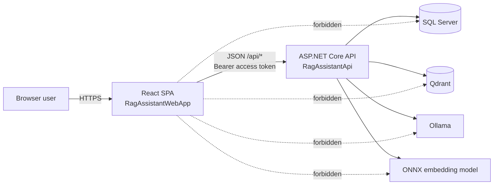
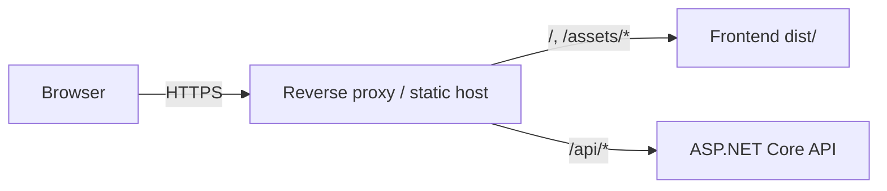

# Frontend Architecture — RAG Assistant

> **Status:** Foundation implemented; product features are not. The React application lives at `frontend/rag-assistant-ui/` and currently contains the shell, routing, providers, environment validation, design tokens, and initial tests. No chat, document, data-source, settings, or authentication feature exists yet.
>
> **Backend baseline:** `RagAssistantApi` (ASP.NET Core 8), source-inspected on 2026-11-15 at commit `afd92ec`.
> At that commit `dotnet build RagAssistant.Api.slnx` fails with one error (`RagAssistant.Api/Controllers/ChatController.cs:31`). No API behavior is runtime-verified.
>
> **Last updated:** 2026-11-15
>
> **Related documents:**
> [Coding standards](./frontend-coding-standards.md) · [Security standards](./frontend-security-standards.md) · [Testing standards](./frontend-testing-standards.md) · [UI/UX guidelines](./frontend-ui-ux-guidelines.md) · [API integration](./frontend-api-integration.md) · [Workflow](./frontend-workflow.md)

---

## 1. Purpose and Scope

This repository contains **one independently deployable single-page application (SPA)** that is the presentation layer of the RAG Assistant. It is located at `frontend/rag-assistant-ui/`; documentation stays at the repository root.

In scope:

- Chat UI (conversation history, streaming-ready message rendering, citations, markdown, code highlighting).
- Document management UI (upload, processing status, listing, deletion, errors).
- Data source management UI (configuration, schema browsing, permissions, source selection).
- Settings UI (AI model, retrieval, embedding, user preferences).
- Authentication UI integrated with the **existing** backend JWT architecture.

Out of scope for this repository:

- Backend business logic.
- Retrieval, embedding, chunking, or prompt construction.
- Any direct connection to SQL Server, Qdrant, Ollama, or the ONNX model.
- Server-side rendering (SSR).
- A second backend or a BFF (backend-for-frontend). The ASP.NET Core API is the only backend.

The frontend is a **consumer of documented HTTP contracts**. Where a contract does not exist or cannot be verified, the corresponding feature is blocked (see §13).

---

## 2. System Context and Hard Boundaries



Non-negotiable boundary rules:

1. The frontend talks **only** to the documented HTTP API (and, if the backend adds one, a documented real-time channel).
2. The frontend never opens a SQL Server connection, a Qdrant gRPC/HTTP connection, or an Ollama request.
3. The frontend never implements retrieval, re-ranking, chunking, prompt assembly, embedding, or authorization decisions.
4. The frontend never executes database queries and never receives database credentials.
5. All protected operations are authorized by the backend. Hiding a control in the UI is a UX affordance, never a security control.
6. No backend business rule is reimplemented in the client. Validation in the client is for UX; the backend remains authoritative.

Violating these rules is an architecture defect, not a code-style issue.

---

## 3. Technology Stack

### 3.1 Selected stack

| Concern | Technology | Baseline | Rationale |
|---|---|---|---|
| UI runtime | React | 19.x | Component model, ecosystem, team requirement |
| Language | TypeScript | 5.9+ (strict) | Compile-time contract safety |
| Build tool | Vite | 8.x (installed 8.3.8) | Fast dev server, native ESM, small config surface |
| Styling | Tailwind CSS | 4.x (`@tailwindcss/vite`) | Utility-first, token-driven theming |
| Component primitives | shadcn/ui | CLI 3.x | Source-owned Radix-based components, no runtime lock-in |
| Routing | React Router | 7.x, **library mode** | SPA routing without framework/SSR mode |
| Server state | TanStack Query | 5.x | Caching, retries, cancellation, invalidation |
| Global client state | Zustand | 5.x, only when justified | Minimal store without boilerplate |
| Forms | React Hook Form | 7.x | Uncontrolled form performance |
| Validation | Zod | 4.x | Runtime validation of inputs **and** environment config |
| Icons | Lucide React | current 0.x | Consistent, tree-shakeable icon set |
| Markdown | React Markdown | 10.x | Safe-by-default markdown (no raw HTML) |
| Code highlighting | rehype-highlight + highlight.js | current | Needed for "code syntax highlighting"; lighter than a full highlighter renderer |
| Unit/integration tests | Vitest | major that supports the chosen Vite major | Shares Vite transform pipeline |
| Component tests | React Testing Library | 16.x | Behavior-oriented tests |
| E2E tests | Playwright | current 1.5x | Cross-browser, reliable auto-waiting |
| Package manager | npm | lockfile v3 | Repository has no established alternative |

The scaffold used a portable **Node.js 24.22.3 LTS / npm 11.19.1** toolchain (Vite 8 requires **≥ 20.19 / ≥ 22.12**). `node`/`npm` are still not on the system `PATH`; the portable helper `%LOCALAPPDATA%\nodejs-portable\env.sh` must be sourced before running project commands. See `PROJECT_CONTEXT.md` §4.1.

### 3.2 Approved supporting tooling

These are not feature libraries; they are required quality gates or mandatory peers:

| Package | Why it is required |
|---|---|
| `eslint` 9 (flat config), `typescript-eslint` 8 | Type-aware linting and React hooks rules |
| `eslint-plugin-react-hooks`, `eslint-plugin-jsx-a11y`, `eslint-plugin-react-refresh` | Hook correctness, accessibility, HMR safety |
| `prettier` 3, `eslint-config-prettier` | Deterministic formatting |
| `@types/react`, `@types/react-dom`, `@types/node` | Type definitions |
| `@tailwindcss/vite` | Official Tailwind 4 Vite integration |
| `@testing-library/dom` | Required peer of RTL 16 |
| `@testing-library/jest-dom`, `@testing-library/user-event` | DOM assertions and realistic interaction |
| `jsdom` | Vitest DOM environment |
| shadcn transitive deps (`class-variance-authority`, `clsx`, `tailwind-merge`, Radix packages, `tw-animate-css`) | Added by the shadcn CLI; do not hand-roll equivalents |
| `openapi-typescript` (optional, later) | Contract type generation once the backend compiles and its OpenAPI document is stable |
| `msw` (optional, dev-only) | Multi-request API simulation in tests; see testing standards |

### 3.3 Explicitly not adopted

Do not add these without a written decision in this document and user approval:

| Rejected | Reason |
|---|---|
| Axios | Native `fetch` plus a typed wrapper is sufficient |
| Redux / Redux Toolkit | TanStack Query covers server state; Zustand covers the little client state left |
| Next.js / Remix | The backend is ASP.NET Core; SSR adds deployment coupling for no current requirement |
| i18next / react-intl | Single locale (Persian) initially; a typed message catalog is enough |
| moment / date-fns | `Intl.DateTimeFormat` covers display; dates arrive as ISO 8601 |
| lodash | Standard ES methods cover current needs |
| styled-components / emotion | Tailwind + CSS variables |
| react-syntax-highlighter / Shiki | Heavier than needed; `rehype-highlight` satisfies the requirement |
| `jwt-decode` | The backend already returns `expiresInSeconds` and expiry timestamps; avoid client-side token parsing for decisions |
| `next-themes` | Next.js-specific; a small theme provider is enough |
| formik | React Hook Form is the chosen form library |
| `uuid` | `crypto.randomUUID()` is available |
| dnd-kit | Native drag-and-drop is enough for upload; only add for reordering with a real requirement |
| List virtualization | Add only after a measured rendering problem |
| `@microsoft/signalr` | No hub exists on the backend; do not install speculatively |
| Error-boundary package | A small class component avoids a dependency for one behavior |

### 3.4 Compatibility notes (verified after scaffolding)

- **React 19 + React Router 7 library mode**: supported; use `createBrowserRouter`, not framework mode.
- **Tailwind 4 + shadcn/ui**: Tailwind 4 uses the `@tailwindcss/vite` plugin and CSS-first configuration; do not generate the legacy `tailwind.config.js`. shadcn must be initialized in Tailwind 4 mode.
- **Zod 4 + React Hook Form**: requires `@hookform/resolvers` 5.x. Do not pair Zod 4 with resolvers 4.x.
- **React Markdown 10**: the `className` prop was removed; wrap the component in a styled container.
- **RTL 16**: `@testing-library/dom` must be installed explicitly as a peer.
- **Vitest and Vite**: current Vitest versions treat `vite` as a **required peer dependency**, not a bundled one, so a mismatched Vite copy breaks resolution. Install a Vitest major whose peer range includes the chosen Vite major and verify with `npm ls vite vitest`.
- **shadcn/ui is not a dependency**: components are copied into `src/components/ui`. Treat them as owned source.
- **Deferred feature libraries**: Zustand, React Hook Form, `@hookform/resolvers`, React Markdown, and rehype-highlight are approved but intentionally not installed until their first real use. Do not install them speculatively.

> **Verification (2026-11-15):** Dependencies are installed and pinned in `package-lock.json`: React 19.3.1, Vite 8.3.8, Vitest 5.1.0, Tailwind 4.3.5, TypeScript 5.9.3, React Router 7.18.5. `npm ls vite vitest` resolves a single `vite@8.3.8` for `vitest@5.1.0`. ESLint is held at 9.39.5 because the documented baseline and `eslint-plugin-jsx-a11y`'s peer range require it; npm marks that release unsupported upstream, and moving to ESLint 10 requires a plugin compatibility review, so it is deferred. Do not claim a different peer graph without re-running `npm ls`.

---

## 4. Repository Layout

The React application lives at `frontend/rag-assistant-ui/`; documentation stays under `Docs/`.

```text
RagAssistantWebApp/
├─ AGENTS.md                    # agent entry point (frontend + preserved backend rules)
├─ PROJECT_CONTEXT.md           # verified facts, status, open questions
├─ Docs/Ai/                     # architecture, standards, workflow, changelog, reviews
└─ frontend/
   └─ rag-assistant-ui/
      ├─ src/
      │  ├─ main.tsx            # bootstrap only
      │  ├─ app/                # composition root: router, providers, error boundary
      │  ├─ components/
      │  │  ├─ ui/              # shadcn-style primitives (owned source)
      │  │  └─ shared/          # generic composed components
      │  ├─ features/           # vertical feature modules (placeholders so far)
      │  ├─ layouts/            # AppShell and future layouts
      │  ├─ pages/              # app-level pages (home, not found, route error)
      │  ├─ lib/                # env validation, query client, cn()
      │  ├─ i18n/               # Persian message catalog
      │  ├─ styles/             # Tailwind entry and theme tokens
      │  └─ test/               # setup and render helpers
      ├─ .env.example
      ├─ components.json        # shadcn CLI configuration
      ├─ eslint.config.js
      ├─ vite.config.ts
      ├─ tsconfig.json
      └─ package.json
```

Planned additions (not created yet): `src/api/` (transport layer), per-feature `api/`, `components/`, `hooks/`, `schemas/`, and `types.ts`, `e2e/` with Playwright, and self-hosted font assets. Each feature currently contains only `routes/` and its `index.ts`; create the remaining slices when the first real use exists.

Rules:

- `src/api` may be imported by any feature; it must never import from `src/features` or `src/components`.
- `src/components/ui` imports only `lib` and other `ui` primitives.
- Features do not import another feature's internals (see §5).
- `app` may import features; features never import `app`.
- No backend source, SQL scripts, or server configuration live in this repository.
- The build is independent of the backend; the two are deployed separately (§12).

---

## 5. Feature-Based Organization

Each product module is a vertical slice:

```text
src/features/chat/
├─ api/
│  ├─ chat.keys.ts             # TanStack Query key factory
│  ├─ chat.queries.ts          # queryFn / queryOptions
│  └─ chat.mutations.ts        # mutation hooks
├─ components/                 # feature-specific UI
├─ hooks/                      # feature-specific non-API hooks (scroll, composer)
├─ routes/                     # route elements rendered by the router
├─ schemas/                    # Zod schemas for forms/URL state
├─ types.ts                    # feature-local types (not wire DTOs)
└─ index.ts                    # the feature's only public surface
```

Features: `auth`, `chat`, `documents`, `data-sources`, `settings`.

Boundary rules:

1. Cross-feature imports go through `features/<name>/index.ts` only.
2. A shared element must be genuinely generic before it moves to `components/common` (rule of three, see coding standards).
3. Wire DTOs belong in `src/api/types`; feature types describe UI state and may combine DTOs.
4. Query keys are owned by the feature that fetches the data. A feature that needs another feature's data imports its public query options, not its internal files.
5. No feature owns routing configuration; routes are composed in `app/router.tsx`.

---

## 6. Component Architecture

Layering, from top to bottom:

```text
Route element (app/router.tsx)
  └─ Page (features/*/routes)        — composes sections, owns page-level state
      └─ Feature component           — domain-aware presentation
          └─ Common component        — generic, domain-agnostic
              └─ ui primitive        — shadcn button, dialog, input, …
```

Rules:

- Only route elements and page-level hooks call data hooks. Presentational components receive data and callbacks via props.
- Components never call `fetch` directly. All network access goes through the API layer (see §9).
- Server data is read from TanStack Query at the route/page level and passed down; avoid every leaf subscribing to the same query.
- Layout components (`AppShell`, `AuthLayout`) contain no business logic.
- Split a component when it mixes concerns (data + form + presentation) or exceeds ~200 lines. Line count is a signal, not a target.
- Prefer composition (`children`, render props) over boolean-prop configuration explosions.
- Do not create a wrapper component that only forwards props.

---

## 7. Routing Strategy

React Router 7 in library mode, with `createBrowserRouter` and `RouterProvider`.

| Path | Access | Purpose | Backend readiness |
|---|---|---|---|
| `/` | public | Redirect to `/chat` | — |
| `/login` | public | Sign in | Endpoint exists in source; backend does not compile |
| `/chat` | authenticated | New conversation | Blocked (see §13) |
| `/chat/:conversationId` | authenticated | Existing conversation | Blocked |
| `/documents` | authenticated | Document list and upload | Blocked |
| `/documents/:documentId` | authenticated | Document details and status | Blocked |
| `/data-sources` | authenticated | Data source list | Blocked |
| `/data-sources/:sourceId` | authenticated | Source config and schema | Blocked |
| `/settings/profile` | authenticated | Account and password | Partial (password change exists) |
| `/settings/ai` | authenticated | Model configuration | Blocked |
| `/settings/rag` | authenticated | Retrieval/embedding settings | Blocked |
| `/settings/preferences` | authenticated | UI preferences | Client-only |
| `*` | public | Not found | — |

Rules:

- Use nested routes with a protected layout (`RequireAuth` renders `<Outlet />` after resolving the session).
- Lazy-load every feature route: `lazy(() => import('...'))` with a Suspense fallback. Code-splitting per feature is mandatory.
- Do not lazy-load the shell or login route.
- Guard behavior:
  - Unauthenticated → redirect to `/login?returnTo=<internal-path>`.
  - `returnTo` must be validated as a same-origin, absolute path starting with `/` and not `//`; otherwise ignore it. This prevents open redirects.
  - After login, navigate to the validated `returnTo` or `/chat`.
- `RequireAuth` shows a full-page skeleton while the session is resolving; it must not flash the login page.
- Permission/role-based menu items are a UX hint. The backend still enforces access; handle `401`/`403` responses with a safe UI state.
- Keep filters, pagination, and selected source in URL search params, not in Zustand.
- Configure `ScrollRestoration`; chat pages manage their own scroll position.
- A route-level error boundary renders per-route failures; the router `errorElement` handles unmatched/loader errors.
- Unknown conversation/document ids must render a "not found" state, not a redirected route.

---

## 8. State Management Strategy

| State kind | Owner | Examples |
|---|---|---|
| Server state | TanStack Query | conversations, messages, documents, sources, settings, schema metadata |
| Session state | React Context + module-level token holder | access token, refresh token handle, current user summary |
| URL state | React Router search params | list filters, pagination, active source |
| Form state | React Hook Form | login, change password, source configuration |
| Ephemeral UI state | Local `useState` | dialog open, composer text, copied state |
| Cross-route client state | Zustand, only if it is needed in 3+ distant places and is not server state | sidebar collapse preference, onboarding dismissal |

Hard rules:

1. **Do not put server data in Zustand.** If it comes from the API, it belongs in TanStack Query.
2. **Do not create a global store for a single screen.** Local state first; lift only when shared.
3. **Do not persist tokens in `localStorage`.** See [security standards](./frontend-security-standards.md).
4. **Clear sensitive caches on logout:** call `queryClient.clear()` and reset the session store. Never show one user's cached data to another.
5. **No Redux.** No duplicate state copies (for example, messages in both a store and the query cache).
6. Derived state is computed, not stored.

TanStack Query defaults (initial proposal; change only with a documented reason):

```ts
{
  retry: (failureCount, error) => !isClientError(error) && failureCount < 1,
  staleTime: 30_000,
  gcTime: 5 * 60_000,
  refetchOnWindowFocus: false,
  refetchOnReconnect: true,
}
```

Chat queries use `staleTime: 0`. Lists that change after mutations are invalidated explicitly, not polled.

---

## 9. Data Fetching Strategy

Mandatory layering:

```text
Component  →  feature data hook  →  TanStack Query  →  feature api module  →  httpClient  →  backend
```

- Components never import `httpClient` directly.
- Feature API modules own endpoint paths, request shapes, and response parsing for that feature.
- `src/api/http-client.ts` owns base URL, headers, cancellation, envelope parsing, and error normalization.
- Query keys come from a typed key factory per feature:

```ts
export const chatKeys = {
  all: ['chat'] as const,
  conversations: () => [...chatKeys.all, 'conversations'] as const,
  conversation: (id: string) => [...chatKeys.all, 'conversation', id] as const,
};
```

Rules:

- Pass the query signal (`queryFn: ({ signal }) => ...`) to every request so unmounting cancels it.
- Mutations invalidate the narrowest key that changed; do not invalidate the whole cache after every write.
- Optimistic updates only for reversible, low-risk UI (for example, renaming a conversation). Roll back on error. Never optimistically confirm document deletion or upload completion.
- Polling is allowed only for processing state, with an interval and a terminal condition. Document polling is blocked until an endpoint exists.
- No request waterfall by design: fetch independent data in parallel.
- No data fetching in render bodies.
- Contract mismatches must fail loudly in development (see API integration, envelope validation).

---

## 10. Error Boundaries

Two levels:

1. **Root boundary** (`app/error-boundary.tsx`): catches unexpected render/lifecycle errors, renders a Persian fallback with "reload" and "go home", and logs a redacted diagnostic.
2. **Route boundary** (router `errorElement` / per-route wrapper): isolates a failing module so the shell and navigation remain usable.

Rules:

- Expected API errors (validation, 401, 403, 404, 409, 500 from the envelope) are handled **inline** by the component, not thrown to a boundary.
- Boundaries reset on navigation (key by `location.key` or pathname).
- Never render raw exception messages, stack traces, tokens, or response bodies in a boundary.
- No extra error-boundary library; implement one class component.
- React Query `onError` is for side effects (logging, toast), not for rendering.
- 404 and permission states are normal UI states, not boundary failures.

---

## 11. Environment Configuration

Configuration is read from `import.meta.env`, validated once at startup with Zod, and exported from `src/lib/env.ts`. The app fails fast with a readable developer error if configuration is invalid.

| Variable | Implemented | Default | Notes |
|---|---|---|---|
| `VITE_API_BASE_URL` | yes | `""` (same origin) | Empty string means same-origin `/api`; an absolute http(s) origin is allowed |
| `VITE_APP_ENV` | yes | `development` | `development` \| `staging` \| `production`; shown in the shell footer and used to gate development-only UI |
| `VITE_ENABLE_DEVTOOLS` | no | — | Not present in `src/lib/env.ts`; TanStack Query devtools are not installed yet |
| `E2E_BASE_URL` | no | — | Reserved for Playwright config; Playwright is not installed yet |
| `E2E_USERNAME` / `E2E_PASSWORD` | no | — | Reserved for E2E only, via an untracked `.env.e2e.local`; never committed |

The implemented schema lives in `frontend/rag-assistant-ui/src/lib/env.ts` and exports only `{ apiBaseUrl, appEnv }`. Add a variable there first, then to `.env.example`, then to this table.

Rules:

- Every `VITE_*` value is **public** and ends up in the browser bundle. Never put secrets, API keys, connection strings, or tokens there.
- Commit `.env.example` with placeholders; commit no real `.env` file.
- Do not read `process.env` in client code.
- Development uses the Vite proxy for `/api` (see below), so no CORS change is needed in development.

---

## 12. Deployment Topology

The frontend and backend are **built and deployed independently** and have no shared code or shared build.



- Development: Vite dev server on `5173` proxies `/api` to `http://localhost:5000` (the backend `http` profile).
- Production: the frontend is static files; `/api` is routed to the backend by a reverse proxy on the **same origin**. This is required because the backend currently has **no CORS policy** (verified: no `AddCors`/`UseCors` in `Program.cs`).
- Do not "fix" this by adding a permissive CORS policy in the frontend repo, and do not ask the browser to bypass CORS.
- SPA fallback: unknown non-`/api` paths must serve `index.html`.
- Cache `/assets/*` immutably (hashed filenames); serve `index.html` with no-cache.
- Frontend and backend must tolerate **version skew**: deploy order must not break an in-flight page. Avoid destructive API shape assumptions; degrade gracefully on unknown fields.
- HTTPS is mandatory outside local development.
- The backend's `UseHttpsRedirection` behavior depends on the launch profile; verify the effective URL when integrating, rather than assuming.

---

## 13. Module Readiness Matrix

Any module marked **Blocked** may have UI scaffolding only if it is clearly non-functional and not presented to users as working. Do not invent endpoints.

| Module | Backend evidence (2026-11-15) | Frontend status |
|---|---|---|
| Authentication | 5 routes exist in `AuthController`; backend does not compile at HEAD | Implementable after backend build is fixed and runtime-verified |
| Chat | `ChatController` exists but is syntactically invalid (duplicate actions, line 31); `ChatAboutFileAsync` always throws (`int.Parse("e")`); no streaming; no persistence endpoints | **Blocked** beyond static UI |
| Conversation management | Tables `chat.ChatConversations`, `ChatMessages`, `ChatMessageSources` exist; no controller | **Blocked** |
| Document upload | `IIndexingService`/`IRagService.UploadFile` exist internally; no HTTP endpoint | **Blocked** |
| Document listing/details/deletion | `doc.Document` table exists; no controller | **Blocked** |
| Data sources | `SiteUserDataSource` only; no schema-browsing endpoint | **Blocked** |
| Settings | Configuration is server-side `appsettings`; no endpoints | **Blocked** |
| Streaming / stop generation | No SSE, `IAsyncEnumerable`, SignalR, or hub registration | **Blocked** |
| Citations | `Conversation` carries only `messageType` + `text`; sources are not returned | **Blocked** |

Blocked modules are not an excuse to fake data in production code. Prototype data may exist only behind a development flag that cannot ship, and only with explicit approval.

---

## 14. Architecture Decisions

| ID | Decision | Status | Consequence |
|---|---|---|---|
| AD-01 | React SPA built with Vite, no SSR | Decided | Simple static deployment; no SEO/server rendering |
| AD-02 | React Router 7 **library mode** | Decided | No framework plugin, no server loaders; all data fetching is client-side |
| AD-03 | Feature-based vertical slices | Decided | Clear ownership; enforced import boundaries |
| AD-04 | TanStack Query is the only server-state cache | Decided | No duplicated API state in Zustand |
| AD-05 | Zustand is opt-in, not default | Decided | Adds a dependency only when justified |
| AD-06 | Single shared HTTP client based on `fetch` | Decided | One place for auth, cancellation, and envelope handling |
| AD-07 | Access token in memory; refresh token in `sessionStorage` (interim) | Decided, awaiting backend cookie support | Survives reload per tab; XSS exposure remains; see security doc |
| AD-08 | Same-origin reverse proxy in production; Vite proxy in development | Decided | Avoids backend CORS changes; requires deployment configuration |
| AD-09 | No direct infra access from the browser | Decided | Security boundary |
| AD-10 | Persian-first, RTL-first UI | Decided | Logical CSS properties, Vazirmatn font |
| AD-11 | Exact dependency versions pinned in `package-lock.json` at scaffold | Decided | Reproducible builds |
| AD-12 | No streaming implementation until a backend contract exists | Decided | UI may show non-streaming behavior only |

---

## 15. Non-Goals (for the initial implementation)

- Offline-first behavior, service workers, or PWA installation.
- Server-side rendering, static site generation, or edge rendering.
- Multi-tenant theming or white-labeling.
- Multiple UI languages (the architecture should not prevent it, but only Persian ships).
- Direct integration with SQL Server, Qdrant, Ollama, or model files.
- Micro-frontends or runtime module federation.
- A second state-management system alongside TanStack Query.
